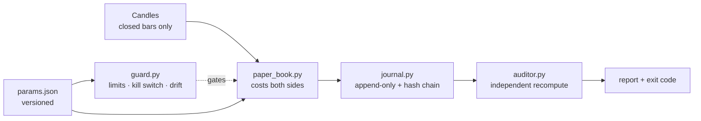

# truth-engine

[](https://github.com/XSlaidx/truth-engine/actions/workflows/ci.yml)
[](LICENSE)
[](https://www.python.org/downloads/)
[](pyproject.toml)

**A harness that tries to prove a trading hypothesis wrong — before it costs money.**

Most trading repositories show a strategy and a beautiful equity curve. This one contains no
strategy and no curve. It contains the boring machinery that decides whether a result is real:
risk limits with durable state, an append-only journal that cannot be edited quietly, an honest
paper book that pays fees and slippage on both sides, and an independent auditor that re-derives
every number from raw candles and fails loudly when the journal disagrees.

It exists because of a specific failure mode: a deterministic loop that *looks* fine for weeks and
then turns out to have been reading a candle that had not closed yet.

---

## What is inside

| File | Role |
|---|---|
| `guard.py` | Risk limits, durable state, kill switches, clock-drift gate, entry permission |
| `journal.py` | Append-only JSONL journal with a SHA-256 hash chain |
| `paper_book.py` | Bar-close simulation: costs on both sides, no invented exits, no lookahead |
| `auditor.py` | Independent verification of the journal (5 checks, non-zero exit on failure) |
| `demo.py` | Offline end-to-end demo: synthetic candles → paper book → journal → audit |
| `tests/` | 29 tests, including the adversarial ones: tampered PnL, injected lookahead, data gaps |
| `params.example.json` | Every limit and cost in one versioned file |

No exchange SDK, no API keys, no network calls: the whole demo runs offline on a seeded random walk.

## Architecture



The loop is deliberately boring: read candles, compute a signal on the last **closed** bar, write
the record. No LLM is involved anywhere on that path — language models are useful around the loop
(reading the journal, drafting a report, sanity-checking a decision), never inside it, because
inside it you need latency you can bound and behaviour you can reproduce.

## Quickstart

```bash
python demo.py                 # candles -> paper book -> journal -> audit, no network
python demo.py --runs 3        # append three runs and audit the whole chain
python auditor.py --journal runs/journal.jsonl --params params.example.json
```

```
run 1: {"DEMOUSDT": {"trades": 12, "net_pct": -1.47, "win_rate": 41.7, "max_drawdown_pct": 2.49}}
run 2: {"DEMOUSDT": {"trades": 12, "net_pct": 1.46, "win_rate": 58.3, "max_drawdown_pct": 0.85}}

audit report
========================================
  PASS  chain
  PASS  gaps
  PASS  no-lookahead
  PASS  pinning
  PASS  recompute
  records: 2
  issues: none
```

Tests:

```bash
uv venv .venv --python 3.11 && uv pip install --python .venv/Scripts/python.exe pytest
./.venv/Scripts/python.exe -m pytest -q      # or: python -m pytest -q
```

## What the auditor actually checks

| Check | Question it answers | Why it matters |
|---|---|---|
| `chain` | Was any record edited, deleted or reordered after the fact? | A journal you can quietly rewrite is a marketing document |
| `pinning` | Do all records carry the expected parameter version? | Silent re-tuning is how a losing rule becomes a "winner" |
| `no-lookahead` | When the rule may only read bars up to the signal bar, does it still produce the recorded signal? | This is the classic way a backtest lies to itself |
| `recompute` | Does an independent re-simulation reproduce every recorded trade result? | The journal's claims must survive a second implementation |
| `gaps` | Are there missing candles in the series that was actually used? | A data hole silently skips trades and flatters the result |

`auditor.py` exits non-zero when any check fails, so it can gate a scheduled job or CI instead of
being a report nobody reads.

## Design rules this code enforces

1. **Closed bars only.** `paper_book.drop_forming()` removes the candle that is still being written.
2. **Costs on both sides.** Commission *and* slippage on entry and exit, taken from `params.json`.
3. **No invented exits.** If a trade has not closed yet, it is not recorded — an open trade is never
   quietly closed at the last available price.
4. **Start-of-day equity is snapshotted at 00:00 UTC.** A daily stop measured against a moving
   balance resets itself all day and never fires.
5. **The loss-streak limit locks the stand and only a human unlocks it.** Automatic resume lets a
   broken strategy restart at the worst possible moment.
6. **Kill switches are files, not flags.** `stop` (soft: no new entries) and `stop_hard` (hard:
   flatten) survive a crashed process, a reboot and a deployment.
7. **Clock drift blocks new entries.** If server time is unavailable, the answer is "cannot verify",
   which means "do not trade".
8. **State is written atomically and read strictly.** A corrupt state file raises instead of being
   silently replaced by "no open positions" — the exact bug that opens a duplicate position.

## What is deliberately not here

* the actual trading rules: this repository is the harness, not the hypothesis;
* exchange client code, keys and order placement — the same guard/auditor pair watches a paper book
  and a live account;
* claims about returns. The demo PnL is a seeded random walk and means nothing; it exists to make
  the pipeline runnable and the tests deterministic.

## Roadmap

- [ ] live-candle provider adapter (read-only) with the same journal schema;
- [ ] weekly digest that runs the auditor on a copy of the journal;
- [ ] slippage-model comparison: recorded demo fills vs simulated ones.

## License

MIT — see [LICENSE](LICENSE).
