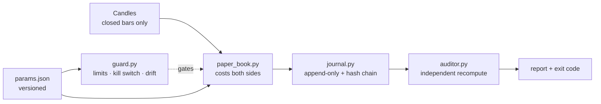

# truth-engine

[](https://github.com/XSlaidx/truth-engine/actions/workflows/ci.yml)
[](LICENSE)
[](https://www.python.org/downloads/)
[](pyproject.toml)

**A harness that tries to prove a trading hypothesis wrong — before it costs money.**

Most trading repositories show a strategy and a beautiful equity curve. This one contains no
strategy and no curve. It contains the boring machinery that decides whether a result is real:
risk limits with durable state, an append-only journal that cannot be edited quietly, an honest
paper book that pays fees and slippage on both sides, and an independent auditor that re-derives
every number from raw candles and fails loudly when the journal disagrees.

It exists because of a specific failure mode: a deterministic loop that *looks* fine for weeks and
then turns out to have been reading a candle that had not closed yet.

---

## What is inside

| File | Role |
|---|---|
| `guard.py` | Risk limits, durable state, kill switches, clock-drift gate, entry permission |
| `journal.py` | Append-only JSONL journal with a SHA-256 hash chain |
| `paper_book.py` | Bar-close simulation: costs on both sides, no invented exits, no lookahead |
| `auditor.py` | Independent verification of the journal (5 checks, non-zero exit on failure) |
| `stats.py` | PSR, Deflated Sharpe Ratio, PBO (CSCV), MinBTL — the multiple-testing arithmetic |
| `demo.py` | Offline end-to-end demo: synthetic candles → paper book → journal → audit |
| `tests/` | 42 tests, including the adversarial ones: tampered PnL, injected lookahead, data gaps |
| `params.example.json` | Every limit and cost in one versioned file |

No exchange SDK, no API keys, no network calls: the whole demo runs offline on a seeded random walk.

## Architecture



The loop is deliberately boring: read candles, compute a signal on the last **closed** bar, write
the record. No LLM is involved anywhere on that path — language models are useful around the loop
(reading the journal, drafting a report, sanity-checking a decision), never inside it, because
inside it you need latency you can bound and behaviour you can reproduce.

## Quickstart

```bash
python demo.py                 # candles -> paper book -> journal -> audit, no network
python demo.py --runs 3        # append three runs and audit the whole chain
python auditor.py --journal runs/journal.jsonl --params params.example.json
```

```
run 1: {"DEMOUSDT": {"trades": 12, "net_pct": -1.47, "win_rate": 41.7, "max_drawdown_pct": 2.49}}
run 2: {"DEMOUSDT": {"trades": 12, "net_pct": 1.46, "win_rate": 58.3, "max_drawdown_pct": 0.85}}

audit report
========================================
  PASS  chain
  PASS  gaps
  PASS  no-lookahead
  PASS  pinning
  PASS  recompute
  records: 2
  issues: none
```

Tests:

```bash
uv venv .venv --python 3.11 && uv pip install --python .venv/Scripts/python.exe pytest
./.venv/Scripts/python.exe -m pytest -q      # or: python -m pytest -q
```

## What the auditor actually checks

| Check | Question it answers | Why it matters |
|---|---|---|
| `chain` | Was any record edited, deleted or reordered after the fact? | A journal you can quietly rewrite is a marketing document |
| `pinning` | Do all records carry the expected parameter version? | Silent re-tuning is how a losing rule becomes a "winner" |
| `no-lookahead` | When the rule may only read bars up to the signal bar, does it still produce the recorded signal? | This is the classic way a backtest lies to itself |
| `recompute` | Does an independent re-simulation reproduce every recorded trade result? | The journal's claims must survive a second implementation |
| `gaps` | Are there missing candles in the series that was actually used? | A data hole silently skips trades and flatters the result |

`auditor.py` exits non-zero when any check fails, so it can gate a scheduled job or CI instead of
being a report nobody reads.

## Statistical honesty: PSR, DSR, PBO, MinBTL

A Sharpe ratio on its own is not evidence. Bailey, Borwein, López de Prado and Zhu showed the
arithmetic that makes this concrete: after **seven** tried configurations, the expected in-sample
Sharpe of a strategy with *zero* real skill on two years of data is about **1.0**, and after ten it
is about **1.57** — while the expected out-of-sample Sharpe stays at zero. The more you search, the
higher the bar has to be.

`stats.py` implements that arithmetic from the primary sources, standard library only:

| Function | What it answers |
|---|---|
| `probabilistic_sharpe_ratio` | Given the sample length, skew and kurtosis, how confident can I be that the true Sharpe exceeds a threshold? |
| `expected_max_sharpe` | If I tried N skill-less configurations with this spread of Sharpe ratios, how good would the winner look by luck alone? |
| `deflated_sharpe_ratio` | PSR with the threshold raised to that expected maximum — the winner's curse removed |
| `pbo_cscv` | Probability of backtest overfitting: does my in-sample winner systematically land below the out-of-sample median? |
| `min_backtest_length_years` | How many years of data do N trials require before the result means anything? |
| `evaluate_gate` | All of the above plus trade count and elapsed weeks → pass, or the exact reasons it did not |

Two anchors are pinned in the tests so the implementation cannot drift: `MinBTL(45 trials, SR target 1)
≈ 5 years` (the number quoted in the paper) and a Monte-Carlo check that `expected_max_sharpe` matches
the simulated average of maxima within 5%.

## Design rules this code enforces

1. **Closed bars only.** `paper_book.drop_forming()` removes the candle that is still being written.
2. **Costs on both sides.** Commission *and* slippage on entry and exit, taken from `params.json`.
3. **No invented exits.** If a trade has not closed yet, it is not recorded — an open trade is never
   quietly closed at the last available price.
4. **Start-of-day equity is snapshotted at 00:00 UTC.** A daily stop measured against a moving
   balance resets itself all day and never fires.
5. **The loss-streak limit locks the stand and only a human unlocks it.** Automatic resume lets a
   broken strategy restart at the worst possible moment.
6. **Kill switches are files, not flags.** `stop` (soft: no new entries) and `stop_hard` (hard:
   flatten) survive a crashed process, a reboot and a deployment.
7. **Clock drift blocks new entries.** If server time is unavailable, the answer is "cannot verify",
   which means "do not trade".
8. **State is written atomically and read strictly.** A corrupt state file raises instead of being
   silently replaced by "no open positions" — the exact bug that opens a duplicate position.

## What is deliberately not here

* the actual trading rules: this repository is the harness, not the hypothesis;
* exchange client code, keys and order placement — the same guard/auditor pair watches a paper book
  and a live account;
* claims about returns. The demo PnL is a seeded random walk and means nothing; it exists to make
  the pipeline runnable and the tests deterministic.

## Prior art, and what is different here

Nothing in this repository is invented from scratch, and pretending otherwise would be the same
dishonesty it is built to catch. The field already has good work:

* **`backtest-audit`** — static AST analysis of backtest code (catches `shift(-n)`, `pct_change(-n)`,
  data leakage, missing costs). It reads code; it does not verify what a run actually did.
* **`botlab-oss`** (MIT) — the full-versus-truncated look-ahead audit, plus cost and readiness checks.
* **`JohnAdeoye/backtesting-framework`** — an engine whose tests include the converse proof that the
  no-lookahead test measures something, with DSR and walk-forward built in.
* **`quantskills/skill-backtesting-bias-avoidance`** — a packaged workflow that builds a bias-free
  engine and audits PBO/DSR (GPL-3.0).
* **qbuntu**, **The Honest Quant**, **Finance Broski** — public honest-scorecard / audit services for
  strategies, with far more data behind them than this repository has.
* **Bailey, Borwein, López de Prado, Zhu** — the statistical foundation (`stats.py` is an
  implementation of their papers, not an interpretation of them).

What is different here is narrow, and it is the only claim worth making: **the evidence trail is
tamper-evident end to end.** `journal.py` chains every run record by hash, so removing or rewriting a
line breaks the chain; `auditor.py` then re-derives every number from the candles stored inside those
records and fails with a non-zero exit code when the journal and the data disagree; and the statistical
gate is applied to *forward* results only, never to a re-run of history. Static analysers cannot see
that a past run was edited; engines cannot prove a published result was not tuned afterwards. That is
the gap this repository tries to fill.

## Roadmap

- [x] statistical gate: PSR, DSR, PBO and MinBTL from the primary sources (`stats.py`);
- [ ] live-candle provider adapter (read-only) with the same journal schema;
- [ ] weekly digest that runs the auditor on a copy of the journal;
- [ ] slippage-model comparison: recorded demo fills vs simulated ones.

## License

MIT — see [LICENSE](LICENSE).
